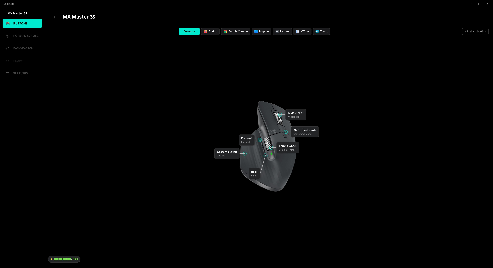
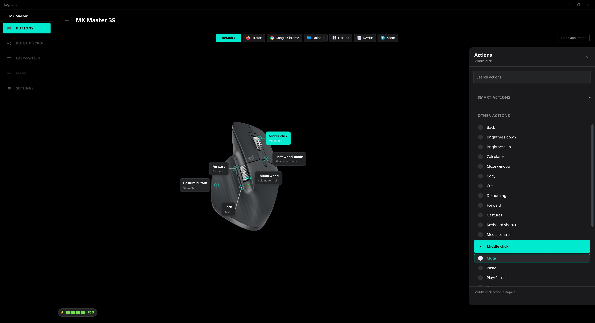
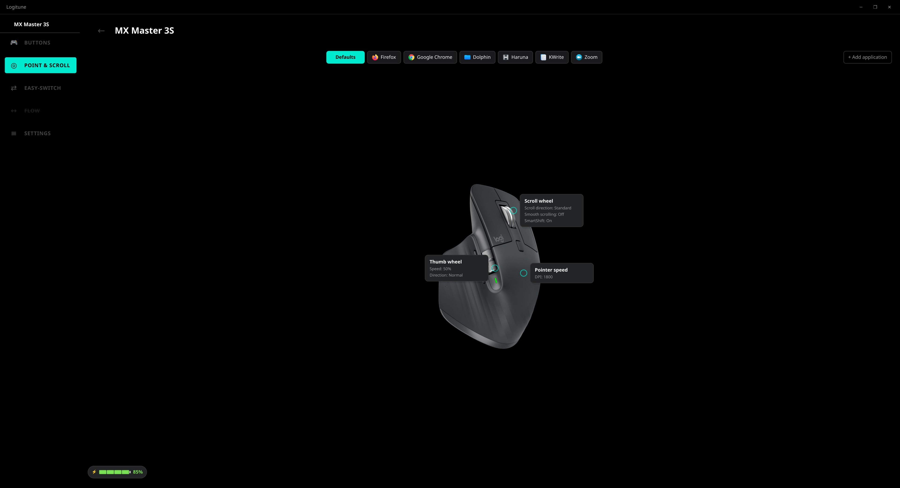
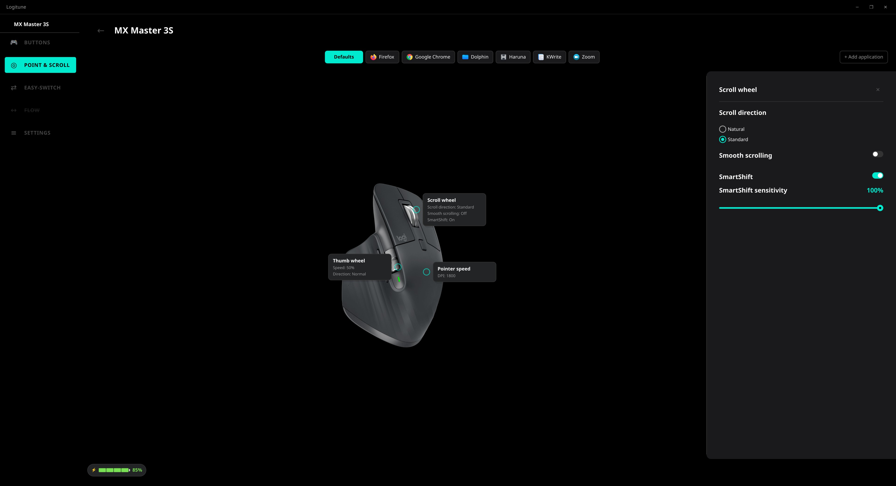
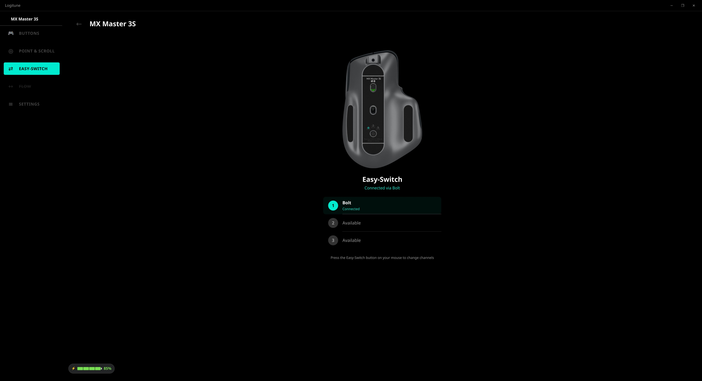
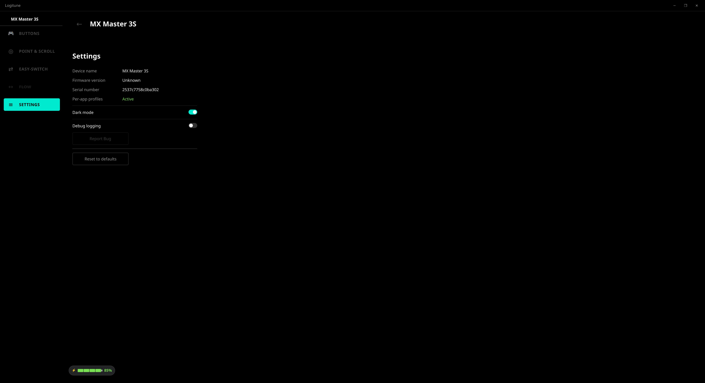

<p align="center">
  
  <h1 align="center">Logitune</h1>
  <p align="center">A Linux configurator for Logitech peripherals — per-application profiles, gesture mapping, thumb wheel modes, and a dark-themed Qt Quick UI matching Logitech Options+.</p>
</p>

<p align="center">
  <a href="https://github.com/mmaher88/logitune/actions/workflows/ci.yml"></a>
  
  
  
  
</p>

<p align="center">
  
</p>

## ✨ Features

- 🖱️ **Per-app profiles** — automatic button/scroll/DPI switching on window focus
- ⌨️ **Button remapping** — keystrokes, media controls, app launch, gestures, SmartShift toggle
- 🎛️ **Thumb wheel modes** — volume, zoom, horizontal scroll with invert control
- 👆 **Gesture support** — hold + swipe for desktop switching, task view, custom keystrokes
- ⚡ **DPI / SmartShift / Scroll** — full control with live preview
- 🔋 **System tray** — battery status, minimize to tray
- 📡 **HID++ 2.0** — direct communication via Bolt receiver, no daemon needed
- 🔄 **Disconnect/reconnect** — automatic re-enumeration and profile reapplication
- 🖥️ **KDE + GNOME** — native focus tracking on both desktops
- 🛠️ **In-app descriptor editor**: launch with `--edit` to position hotspots, upload images, and tune labels without hand-editing JSON. [Learn more](https://github.com/mmaher88/logitune/wiki/Editor-Mode)

## 📸 Screenshots

<p align="center">
  
  <br>
  <em>Action selection panel</em>
</p>

<details>
<summary><strong>More screenshots</strong></summary>

<p align="center">
  
  <br>
  <em>Scroll, thumb wheel &amp; pointer speed</em>
</p>

<p align="center">
  
  <br>
  <em>Scroll direction, SmartShift, smooth scrolling</em>
</p>

<p align="center">
  
  <br>
  <em>Easy-Switch channel management</em>
</p>

<p align="center">
  
  <br>
  <em>Device info, dark mode, debug logging</em>
</p>

</details>

## 🚀 Install

**Ubuntu 24.04 (via OBS repo):**
```bash
echo 'deb http://download.opensuse.org/repositories/home:/mmaher88:/logitune/xUbuntu_24.04/ /' | sudo tee /etc/apt/sources.list.d/logitune.list
wget -qO- https://download.opensuse.org/repositories/home:mmaher88:logitune/xUbuntu_24.04/Release.key | gpg --dearmor | sudo tee /etc/apt/trusted.gpg.d/logitune.gpg > /dev/null
sudo apt update && sudo apt install logitune
```

**Fedora 42 (via OBS repo):**
```bash
sudo dnf config-manager addrepo --from-repofile=https://download.opensuse.org/repositories/home:mmaher88:logitune/Fedora_42/home:mmaher88:logitune.repo
sudo dnf install logitune
```

**Arch Linux (AUR):**
```bash
yay -S logitune
```

**From source:**
```bash
cmake -B build -G Ninja -DCMAKE_BUILD_TYPE=Release -DCMAKE_INSTALL_PREFIX=/usr
cmake --build build
sudo cmake --install build
logitune
```

## 📚 Documentation

| Guide | Description |
|-------|-------------|
| [🏁 Getting Started](https://github.com/mmaher88/logitune/wiki/Getting-Started) | Installation, permissions, UI overview |
| [🔨 Building](https://github.com/mmaher88/logitune/wiki/Building) | Prerequisites, build commands, native packages, devcontainer |
| [🏗️ Architecture](https://github.com/mmaher88/logitune/wiki/Architecture) | System design, signal flow, 14 Mermaid diagrams |
| [🖱️ Adding a Device](https://github.com/mmaher88/logitune/wiki/Adding-a-Device) | Step-by-step guide with code examples |
| [🖥️ Adding a Desktop Environment](https://github.com/mmaher88/logitune/wiki/Adding-a-Desktop-Environment) | KDE + GNOME implementation, adding new DEs |
| [🧪 Testing](https://github.com/mmaher88/logitune/wiki/Testing) | Philosophy, 4 test tiers, writing tests |
| [📡 HID++ Protocol](https://github.com/mmaher88/logitune/wiki/HID++-Protocol) | Report format, features, Bolt receiver, async matching |
| [🤝 Contributing](https://github.com/mmaher88/logitune/wiki/Contributing) | Workflow, code style, commit format |

## 🖱️ Supported Devices

<!-- BEGIN DEVICES TABLE -->
| Device | Status | Battery | DPI | SmartShift | Thumb wheel | Button remap | Gestures | Smooth scroll | Easy-Switch |
|--------|:------:|:--:|:--:|:--:|:--:|:--:|:--:|:--:|:--:|
| MX Master 2S | ✅ Verified | ✅ | ✅ | ✅ | ✅ | ✅ | ✅ | ✅ | ✅ |
| MX Master 3 | ✅ Verified | ✅ | ✅ | ✅ | ✅ | ✅ | ✅ | ✅ | ✅ |
| MX Master 3S | ✅ Verified | ✅ | ✅ | ✅ | ✅ | ✅ | ✅ | ✅ | ✅ |
| MX Master 4 | ✅ Verified | ✅ | ✅ | ✅ | ✅ | ✅ | ✅ | — | ✅ |
| MX Anywhere 3 | 🧪 Beta | ✅ | ✅ | ✅ | — | ✅ | — | ✅ | ✅ |
| MX Anywhere 3 for Business | 🧪 Beta | ✅ | ✅ | ✅ | — | ✅ | — | ✅ | ✅ |
| MX Anywhere 3S | 🧪 Beta | ✅ | ✅ | ✅ | — | ✅ | — | ✅ | ✅ |
| MX Anywhere 3S for Business | 🧪 Beta | ✅ | ✅ | ✅ | — | ✅ | — | ✅ | ✅ |
| MX Vertical | 🧪 Beta | ✅ | ✅ | — | — | ✅ | — | ✅ | ✅ |
| MX Vertical for Business | 🧪 Beta | ✅ | ✅ | — | — | ✅ | — | ✅ | ✅ |
<!-- END DEVICES TABLE -->

> **MX Master 4 smooth scrolling** is disabled in the shipped descriptor: the hardware does not respond correctly to the HID++ configuration used on MX Master 2S / 3S. Regular scroll wheel and SmartShift work normally; only sub-tick smoothing is unavailable. Re-enable yourself by setting `"smoothScroll": true` in `devices/mx-master-4/descriptor.json` if your unit behaves differently; if it works we will promote the default.

The four MX Anywhere family descriptors ship as 🧪 **Beta** pending hardware confirmation. Issue [#46](https://github.com/mmaher88/logitune/issues/46) tracks the verification.

Other Logitech HID++ 2.0 devices can be added by contributing a [device descriptor](https://github.com/mmaher88/logitune/wiki/Adding-a-Device). See [Device Support Status](https://github.com/mmaher88/logitune/wiki/Getting-Started#device-support-status) for what the badges mean.

## 🖥️ Desktop Environment Support

| Feature | KDE Plasma 6 | GNOME 42+ (Wayland) | Hyprland | Other DEs |
|---------|:---:|:---:|:---:|:---:|
| Button remapping | ✅ | ✅ | ✅ | ✅ |
| Media controls | ✅ | ✅ | ✅ | ✅ |
| DPI / SmartShift / Scroll | ✅ | ✅ | ✅ | ✅ |
| Thumb wheel modes | ✅ | ✅ | ✅ | ✅ |
| Gesture actions | ✅ | ✅ | ✅ | ✅ |
| Per-app profiles | ✅ | ✅ | ✅ | ❌ |
| Auto profile switching | ✅ | ✅ | ✅ | ❌ |
| Block shortcuts during capture | ✅ | ✅ | ❌ | ❌ |
| System tray | ✅ | ✅ | ✅ | ✅ |

> **Note:** All device configuration (buttons, DPI, scroll, gestures, thumb wheel) works on every DE — it's pure HID++ over hidraw. Per-app profile switching requires desktop-specific focus tracking. KDE uses a KWin script, GNOME uses a Shell extension (auto-installed on first run), and Hyprland subscribes to the compositor's event socket. Hyprland has no stable compositor-wide shortcut-blocking API, so global bindings may still fire while capturing a keystroke — capture itself works. See [Adding a Desktop Environment](https://github.com/mmaher88/logitune/wiki/Adding-a-Desktop-Environment) to contribute support for other DEs.

## 🛠️ Tech Stack

C++20 · Qt 6 Quick · CMake · HID++ 2.0 · GTest

## 📄 License

[GPL-3.0-only](https://spdx.org/licenses/GPL-3.0-only.html)

### Action Ring

Assign **Radial menu** to a mouse button in **Buttons**. A single press opens
Action Ring around the cursor; release the side button and click an icon to run
its action. Press the side button again or click the center cross to dismiss.
The overlay accepts pointer input without taking keyboard focus from the target
application. Existing hold-and-swipe gestures remain a separate assignment.

Open **Action Ring** using the ring icon next to Settings on the home screen,
or **Configure Action Ring** in the button assignment panel. The separate editor
shows a large ring with external labels, compact application-profile icons above,
and a categorized action catalog on the right. The search icon opens search;
the gear opens device selection, ring size and the link to button settings. The ring has eight fixed slots. Drag actions from the
catalog to assign them, or drag between slots to swap. Select a slot and click an
action in the catalog as an alternative to dragging. Each action has an editable
name and an optional icon from the visual palette. Double-click an action or use
the pencil to edit it; right-click also offers editing and clearing the slot.

Use **Launch application** to search installed applications and choose a launcher.
The **Launch** category is expanded by default, with **Launch application** first.
Other categories group keyboard/editing, media, navigation, system, window, device
and folder actions. Search looks through all categories, including collapsed ones;
clear it to return to the expanded category. An empty search result is shown explicitly.
The application name and icon are filled automatically; click **Save** to assign it
to the selected slot (including slots inside folders). The picker reads XDG desktop
entries, including Flatpak and Snap exports, respects hidden entries and user
overrides, and launches through `gio launch` so desktop-file arguments and field
codes are handled by GIO. The `gio` command (GLib tools) must be installed.
**Launch command** remains available for custom executables and arguments.

Folders contain up to nine actions (one folder level). Click a folder to enter it;
the center arrow returns to its position in the main ring. Dragging an action onto
a folder adds it to the first free slot; moving an existing ring action clears its
old slot. Full folders reject the drop without losing either binding. New folders
open after naming; renaming a folder keeps its children. Replacing or deleting a
folder asks for confirmation. Clear individual slots without moving other bindings.
The undo/redo icons restore or reapply the last edit. **Copy ring** / **Paste ring**
transfer a complete layout, including folders, between application profiles in
this editor. Copy, paste and presets are in the **…** menu. Applying a preset or
pasting asks before replacing the current ring.
Presets include everyday actions, browser shortcuts (Firefox/Chromium), file
manager shortcuts (Dolphin/Nautilus), and VS Code shortcuts. Select or add the
application profile first, then apply a preset; shortcuts assume default app
bindings and can be customized. Existing profile tracking chooses the ring for
the foreground application.

Volume and brightness adjustment actions stay open. Hover and use the scrollwheel
or diverted thumbwheel, or drag horizontally; the caption reports relative steps,
while the desktop's OSD reports the actual level. These actions use the same
system media keys as the existing button bindings (brightness depends on display
and desktop support). The thumbwheel requires the device's diverted wheel events.
Choose Small, Medium or Large under the Action Ring gear; the size is saved globally.
Both the menu and editor follow the application's light/dark theme. Old short-press
bindings are preserved in profiles but are not executed by the click-to-open menu.

On Qt 6.5+, the optional **LayerShellQt 6** development package enables native
Wayland positioning for KDE/wlroots compositors. On KDE/Wayland, the cursor is
queried once through KWin. At screen edges the menu shifts inward to remain visible.
X11 uses Qt's global pointer position; other Wayland desktops use Qt as a
best-effort fallback and need compositor-specific verification.

Commands are launched directly as an executable and arguments; shell expressions
require an explicit shell command. Third-party plugin loading is a separate future
feature. Existing action bindings reuse the shared catalog and serialized
`ButtonAction`; version 2 ring profiles also store folders, empty slots, icon
choices and adjustment actions. Old 2–8 action profiles are padded with empty
slots without losing their bindings. Esc and clicks outside the overlay window
are not captured globally; dismiss using the trigger, center cross or blank area
inside the overlay.
